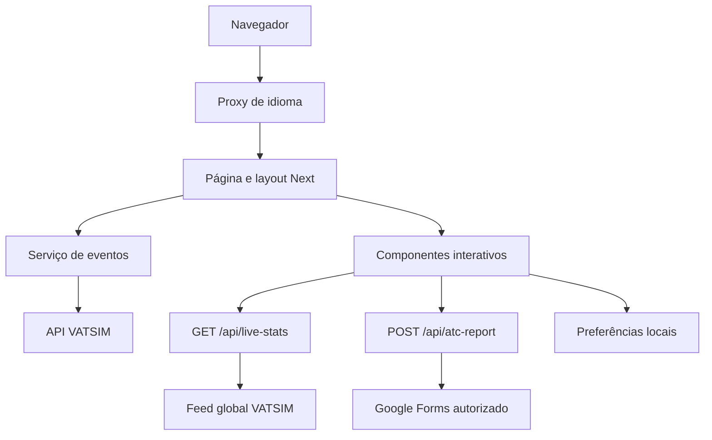

# Arquitetura

[Índice](README.md) · [Componentes](COMPONENTS.md) · [APIs](API.md)

## Organização

```text
src/
  app/
    [lang]/                 Layout, páginas e interfaces locais
      events/               Página e EventsClient
      staff/                Página e StaffClient
      resources/atc-report/ Formulário público de reporte
    api/                    events, live-stats e atc-report
    globals.css             Tokens e estilos compartilhados
  components/
    ui/date-time/           DatePicker, TimePicker e base comum
    PortalUI.tsx            Títulos, links e ajuda
    ...                     Navegação e funcionalidades
  dictionaries/             Conteúdo JSON PT/EN
  lib/                      Regras e contratos auxiliares
  services/                 Dados VATSIM e modelo de equipe
  getDictionary.ts          Dicionários no servidor
  proxy.ts                  Prefixo de idioma
public/                     Assets acessíveis por URL
tests/                      Testes com transporte externo simulado
docs/                       Referência técnica e de produto
```

## Renderização e fluxos

O site usa App Router. Páginas recebem `params` assíncronos, definem metadados e compõem componentes. Interações de navegador ficam em componentes com `"use client"`.



A agenda consulta diretamente o serviço VATSIM no servidor. `/api/events` reutiliza o mesmo serviço, mas a página não chama essa rota internamente. `NetworkPanel` consulta `/api/live-stats` no navegador. O reporte é validado no servidor antes do encaminhamento ao Google Forms.

| Camada | Exemplos | Responsabilidade |
| --- | --- | --- |
| Páginas/layout | `page.tsx`, `layout.tsx`, `CareerPage` | Estrutura, textos e dados iniciais |
| UI interativa | `ResourceDirectory`, `EventsClient`, `StaffClient`, `AtcReportForm` | Estado e eventos de usuário |
| Base de UI | `PortalUI`, `Icon`, `ui/date-time` | Reutilização visual e comportamento |
| Utilitários | `portal`, `date-time`, `atc-report` | Regras e transformações |
| Serviços/rotas | `services/vatsim`, `app/api/*` | Fontes externas e respostas HTTP |

`getDictionary.ts` importa `server-only`. Não o importe em componentes de cliente. Passe textos pela página ou use `t(lang, pt, en)` para textos curtos.

## Idiomas

As rotas aceitam `pt-br` e `en`. Sem prefixo, `proxy.ts` usa `Accept-Language`, `negotiator` e `intl-localematcher`, com fallback `pt-br`. APIs, caminhos internos do Next e determinados assets são ignorados. O layout rejeita idiomas não suportados.

Há traduções em JSON e em `t()` nos componentes. Novos textos devem contemplar ambos os idiomas. O seletor troca o prefixo e preserva o caminho; atualmente não preserva parâmetros de busca nem o rascunho de formulário ao navegar.

## Estado e persistência

| Estado | Local | Duração |
| --- | --- | --- |
| Tema | `localStorage`: `vatbrz-theme` | Até remoção pelo navegador/usuário |
| Favoritos | `localStorage`: `vatbrz-favorites` | Mesmo navegador e origem |
| Checklist piloto | `sessionStorage`: `vatbrz-checklist-pilot` | Sessão da aba |
| Checklist ATC | `sessionStorage`: `vatbrz-checklist-atc` | Sessão da aba |
| Busca/filtros | React; recursos podem receber `q`/`category` inicialmente | Instância da página |
| Reporte ATC | Estado React | Enquanto a página permanece montada |
| Seletores | Valor controlado pelo pai; edição temporária no painel | Instância aberta |
| Rede regional | Memória do processo e cache HTTP | 60 segundos no processo; ver API |

Não há banco de dados, sincronização entre dispositivos ou sessão autenticada.

## Página e assets

O layout adiciona navegação e rodapé uma vez. Cada página fornece `<main id="main-content">`, normalmente com `PageHeading` e `container page-body`. `loading.tsx` e `not-found.tsx` fornecem estados de rota; não há `error.tsx` customizado.

`public/logos` contém três versões do logotipo em PNG/SVG. Qualquer arquivo em `public` pode ser servido diretamente, inclusive arquivos legados não usados pelos componentes.

O layout define `metadataBase` como `https://vatbrz.net`, template de título e Open Graph. Páginas têm títulos localizados; descrição e locale Open Graph do layout permanecem em português. Não há sitemap, robots ou alternates canônicos específicos implementados. Confira domínio e necessidades de metadados antes de publicar.
