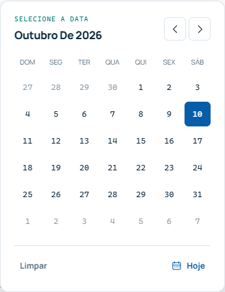
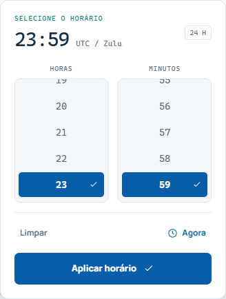

# Catálogo de componentes e bibliotecas

[Índice](README.md) · [Design](DESIGN.md) · [Seletores](DATE_TIME_PICKERS.md)

## Estrutura compartilhada

Todos os caminhos da tabela estão em `src/components`, salvo indicação contrária. `lang` usa os valores de rota `pt-br` ou `en`; os seletores usam locales de apresentação como `pt-BR` e `en-GB`.

| Componente | Propriedades | Uso e responsabilidade |
| --- | --- | --- |
| `NavBar` | `lang: string` | Navegação, idioma, tema, menu móvel e área do membro |
| `Footer` | `lang: string` | Links institucionais e de comunidade |
| `ThemeToggle` | `lang?: string = "pt-br"` | Alterna tema e persiste preferência |
| `UtcClock` | Nenhuma | Exibe HH:mm UTC, atualiza a cada segundo após montar |
| `Icon` | `name: IconName`, `size?: number = 20`, `className?`, `style?` | Ícones SVG decorativos tipados |

O layout já renderiza `NavBar` e `Footer`. Não adicione uma segunda instância nas páginas.

## Modelos em PortalUI.tsx

| Export | Propriedades obrigatórias | Opcionais |
| --- | --- | --- |
| `PageHeading` | `lang`, `label`, `title`, `description`, `icon: IconName` | — |
| `SectionHeading` | `title` | `eyebrow`, `children`, `action` |
| `ActionLink` | `href`, `children` | `secondary = false`, `className = ""` |
| `HelpBanner` | `lang` | — |

`PageHeading` gera o `h1`, contexto e breadcrumb simples para o início. `SectionHeading` gera `h2`, descrição e ação opcional. `ActionLink` representa navegação: endereços começando com `https://` abrem em nova aba com `noopener noreferrer`. Para uma ação no formulário, use `button`, não `ActionLink`.

```tsx
import { PageHeading, SectionHeading, ActionLink, HelpBanner } from "@/components/PortalUI";
import { t } from "@/lib/portal";

export default async function Page({ params }: { params: Promise<{ lang: string }> }) {
  const { lang } = await params;
  return <main id="main-content">
    <PageHeading lang={lang} label={t(lang, "Guias", "Guides")}
      title={t(lang, "Prepare sua sessão", "Prepare your session")}
      description={t(lang, "Orientações para começar.", "Guidance to get started.")}
      icon="book" />
    <div className="container page-body">
      <SectionHeading title={t(lang, "Materiais", "Materials")}
        action={<ActionLink href={`/${lang}/resources`}>{t(lang, "Ver recursos", "View resources")}</ActionLink>} />
      <HelpBanner lang={lang} />
    </div>
  </main>;
}
```

O exemplo é um modelo; a rota `/guias` não existe no projeto atual. Ao criar uma página real, inclua também metadados localizados.

## Funcionalidades do portal

| Componente | Contrato | Estado e dependências |
| --- | --- | --- |
| `CareerPage` | `lang`, `atc?: boolean = false` | Modelo de página piloto/ATC; compõe recursos e checklist |
| `FlightChecklist` | `lang`, `atc?: boolean = false` | Quatro itens por perfil; progresso e reinício; `sessionStorage` |
| `ResourceDirectory` | `lang`, `initialQuery?: string = ""`, `initialCategory?: string = "all"` | Catálogo de `getResources`; busca, filtros e favoritos |
| `NetworkPanel` | `lang` | Estados loading/ready/error; consulta `/api/live-stats` a cada 60 s |
| `BrandPalette` | `lang` | Cinco cores e cópia por Clipboard; trata falhas |
| `AtcReportForm` | `lang` | Preenchimento, revisão, envio, falha preservando dados e confirmação |
| `EventsClient` | `initialEvents: VatsimEvent[]`, `unavailable: boolean`, `lang`, `referenceTime: number` | Filtros, fuso, briefing e `.ics`; localizado em `app/[lang]/events` |
| `StaffClient` | `staffData: StaffDepartment[]`, `lang`, `demo?: boolean = false` | Busca, departamentos, vagas e aviso de demonstração; localizado em `app/[lang]/staff` |

Mantenha a lógica de rede nos serviços/rotas e passe os dados necessários à UI. `initialQuery` e `initialCategory` inicializam o estado; não são uma API de sincronização contínua de filtros externos.

## Biblioteca de data e hora

Importe pelo ponto público:

```tsx
import { DatePicker, TimePicker } from "@/components/ui/date-time";
import type { DatePickerProps, TimePickerProps } from "@/components/ui/date-time";
```

Os dois componentes recebem valor controlado e `onChange`. `PickerField` é a base interna para rótulo, erro, botão e popover: não é o ponto de extensão de formulários consumidores. A biblioteca compartilha `Pickers.module.css` e as funções em `src/lib/date-time.ts`.




Consulte [propriedades, exemplos e atalhos](DATE_TIME_PICKERS.md). Não recrie seletores nativos de `date`/`time` para o mesmo fluxo visual.

## Utilitários e modelos

| Arquivo | Exports e responsabilidade |
| --- | --- |
| `lib/portal.ts` | `Lang`, `Resource`, `t`, `links`, `getResources`, `safeExternalUrl` |
| `lib/date-time.ts` | `parseDate`, `dateValue`, `addDays`, `addMonths`, `clampDate`, `calendarDays`, `isTime`, `zonedNow` |
| `lib/atc-report.ts` | `ATC_RATINGS`, `AtcReport`, `ReportErrors`, `emptyReport`, `validateAtcReport` |
| `lib/atc-report-delivery.ts` | `ATC_REPORT_ENDPOINT`, `toGoogleForm`, `isReportConfirmed`; usado pelo servidor |
| `services/vatsim.ts` | `VatsimEvent`, `EventResult`, `getBrazilianEventsResult`, `getBrazilianEvents`, `getNextBrazilianEvent` |
| `services/staff.ts` | `StaffMember`, `StaffDepartment`, `STAFF_DATA_IS_DEMO`, `getStaffData` |
| `getDictionary.ts` | `getDictionary`, exclusivo do servidor |

`safeExternalUrl` aceita somente URLs HTTPS e retorna `undefined` para entradas inválidas. `parseDate` retorna `Date` UTC ou `null`; `calendarDays` monta 42 posições; `zonedNow` calcula o dia/horário no fuso informado. Não converta uma data sem horário pelo fuso local do navegador.

## Evolução dos componentes

Antes de criar um componente, procure um contrato equivalente no catálogo. Generalize somente o que já tem uso comum: rótulos, estados, valores, callbacks e idioma. Preserve IDs independentes, validação no formulário e a possibilidade de usar várias instâncias. Mudanças públicas devem atualizar esta referência e os testes correspondentes.
